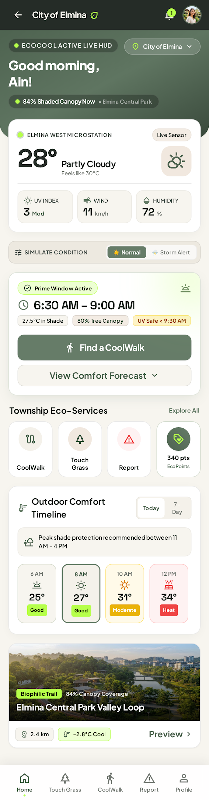
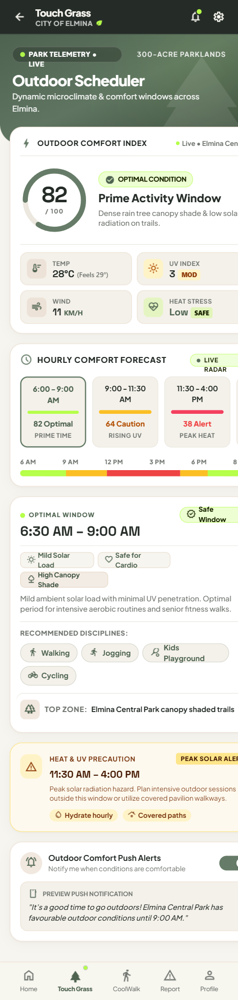
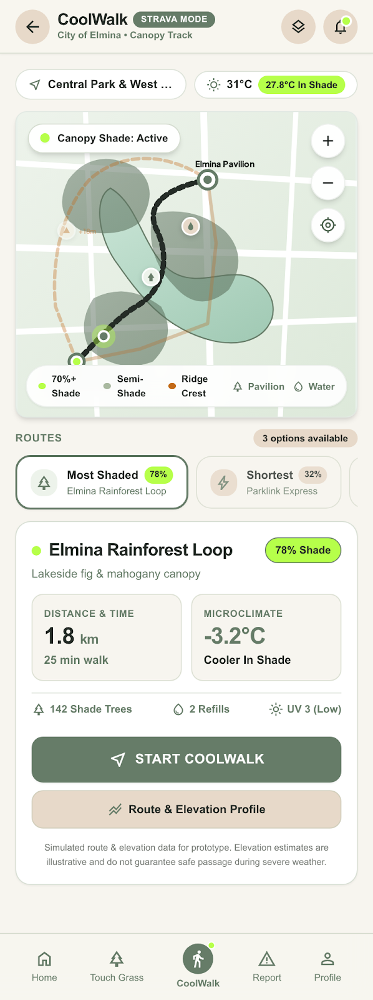
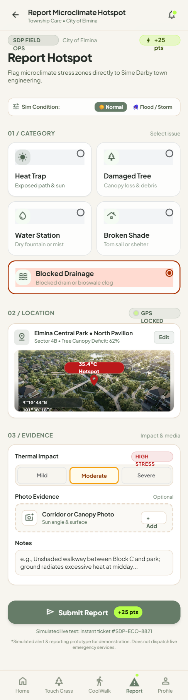
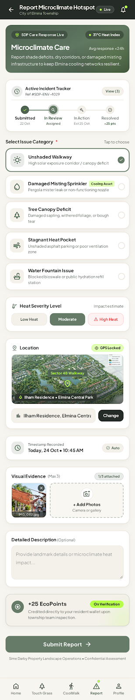
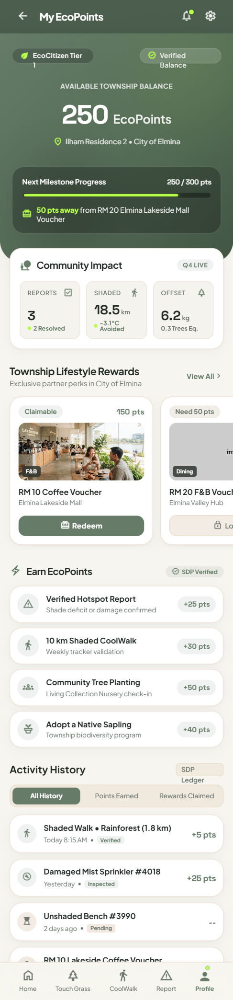
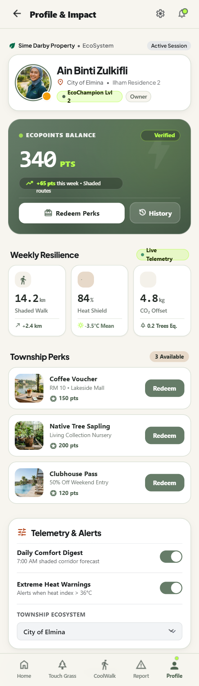
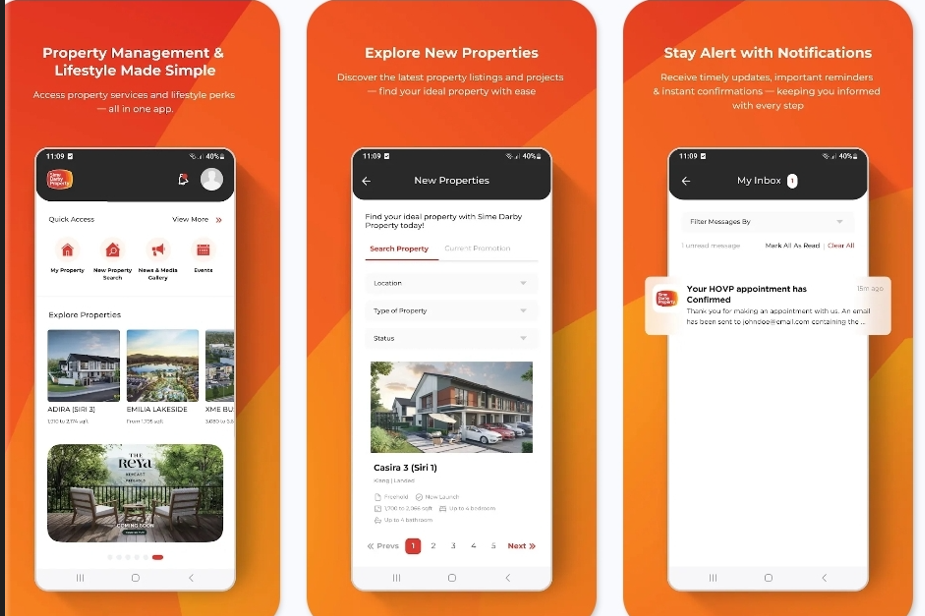

# 🌿 AeroThermal SDP — EcoCool Resident Companion
### *Interactive B2C Mobile Prototype (iPhone 18 Pro • 2TB Titanium Edition)*
**Sime Darby Property University Hackathon 2026 — "Township of Tomorrow"**

---

### 👉 **[LIVE INTERACTIVE DEMO (NO INSTALLATION REQUIRED): `https://nurewnn.github.io/aerothermal-resident-app/`](https://nurewnn.github.io/aerothermal-resident-app/)** 👈
*(Open the link above on any laptop or desktop browser to interact directly with the **iPhone 18 Pro** prototype, switch live climate scenarios, and test all 7 resident screens in real time!)*

---

## 📸 Sneak Peek — 7 Live Interactive Screens

| **1. Home + Dynamic Flood Alert** | **2. Touch Grass Scheduler** | **3. CoolWalk & High-Ground Trails** | **4. Report Hotspot / Clogged Drain** |
| :---: | :---: | :---: | :---: |
|  |  |  |  |
| *Live microstation telemetry, Prime Comfort Windows & 80% Retention Lake Surge Warning* | *Outdoor Comfort Index (0–100), hourly UV/Heat radar & push notification scheduler* | *85% ERT canopy shaded pedestrian paths + storm-mode elevated flood detour* | *Crowdsourced citizen sensing (+25 EcoPoints) for clogged drains, fallen branches & heat* |

| **5. Active Incident Tracker** | **6. My EcoPoints & Perks** | **7. Resident EcoProfile & Wallet** |
| :---: | :---: | :---: |
|  |  |  |
| *Live status tracking (`Received` → `Dispatched` → `Resolved`) synced with B2B Operations* | *Redeem EcoPoints for Elmina Lakeside Mall coffee vouchers, pool passes & native saplings* | *Personal CO₂ savings, shaded distance milestones & instant QR Passkey redemption* |

---

## 💡 Why We Built This: Upgrading the Existing SDP Resident App

During our industry & operator validation with **Sime Darby Property personnel**, we identified a critical engagement gap:

1. **Static Property Utility vs. Daily Climate Companion:** Residents currently open the existing SDP App primarily for static tasks (property listings, defect logging, or appointment reminders) and lack **live environmental safety alerts** when retention lakes rise during cloudbursts or when midday urban heat islands peak.
2. **Passive Retention Basins Need Active Citizen Eyes:** Townships like **City of Elmina** and **Bandar Bukit Raja** have world-class retention lakes and **30,100+ insured ERT (Endangered, Rare & Threatened) biological tree assets**, yet localized flash floods still occur when roadside bioswales/drains clog with debris right before a storm.

### 🔄 Before vs. After
| **Current SDP App (Static Property Tool)** | **AeroThermal EcoCool Upgrade (Active Climate & Safety Companion)** |
| :---: | :---: |
|  |  |
| *Property browsing, HOVP appointments & static inbox* | *Daily "Touch Grass" comfort windows, 85% canopy CoolWalk routing, live 80% retention lake surge warnings & gamified citizen reporting* |

---

## 🎮 Judge's 60-Second Interactive Walkthrough

Click **[`https://nurewnn.github.io/aerothermal-resident-app/`](https://nurewnn.github.io/aerothermal-resident-app/)** and try these interactive features:

1. **🎛️ 1-Click Live Scenario Simulator (Left Panel):**
   - Click **`☀️ Morning Canopy Window (28°C • Optimal)`** → Watch the phone display optimal park hours (`6:30 AM – 9:00 AM`) with floating golden forest sunbeams in the background.
   - Click **`🌊 Retention Lake Breeze (42% Basin)`** → Switch the ambient stage to shimmering retention lake water ripples.
   - Click **`⛈️ Flash Flood Surge Alert (82% Alert)`** → Watch the iPhone Dynamic Island turn red (`FLOOD ALERT`), the Home Dashboard trigger an **82% Retention Lake Capacity Surge Warning**, and the background erupt into a monsoon rainstorm!
2. **🌳 Touch Grass Scheduler (`Touch Grass` Tab):**
   - Tap through the horizontal **Hourly Comfort Forecast** time slots (`6:00 AM`, `9:00 AM`, `11:30 AM Peak Heat`, `5:30 PM Cool Breeze`) to see the live **Outdoor Comfort Index ring (`82/100` → `38/100`)** and activity recommendations update dynamically.
3. **🚶‍♂️ CoolWalk Shaded & High-Ground Routing (`CoolWalk` Tab):**
   - Compare **Most Shaded (`85% ERT Canopy • -3.2°C Cooler`)**, **Shortest**, and **High-Ground (`Flood-Safe Ridge Detour`)** routes with interactive map polylines.
4. **📸 Report a Clogged Drain or Hotspot (`Report` Tab):**
   - Toggle between `☀️ Normal` and `⛈️ Storm Alert`, select **Drainage / Flood Risk**, and submit a report to earn **`+25 EcoPoints`** (synced across all screens via `localStorage`).
5. **🎁 Redeem Township Rewards (`Profile` / `My EcoPoints`):**
   - Click **Redeem** on an *Elmina Lakeside Mall Coffee Voucher* or *Clubhouse Pool Pass* and confirm redemption to generate an instant Resident Passkey QR code.

---

## 🔗 Connected Ecosystem (B2C Mobile App ↔ B2B Masterplanner Twin)

- **📱 B2C Resident Companion (This Repository):**
  - **Live Demo:** [`https://nurewnn.github.io/aerothermal-resident-app/`](https://nurewnn.github.io/aerothermal-resident-app/)
  - **Source Code:** [`https://github.com/nurewnn/aerothermal-resident-app`](https://github.com/nurewnn/aerothermal-resident-app)
- **🏙️ B2B Masterplanner & Operations Digital Twin (Django GIS Platform):**
  - **Repository:** [`https://github.com/d1msums/ecocool`](https://github.com/d1msums/ecocool) (Fork: [`https://github.com/nurewnn/ecocool`](https://github.com/nurewnn/ecocool))
